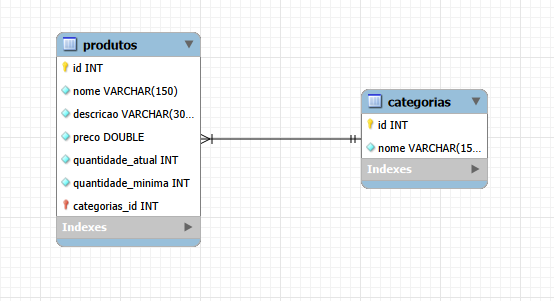
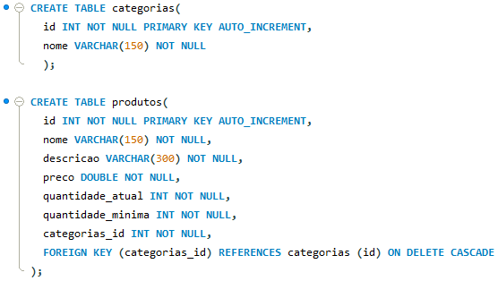
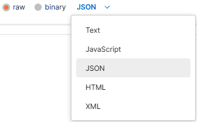

#DER da API:


#Configuração da Conexão entre a API e o Banco de Dados:
 ```env
   DB_HOST=localhost  // <-- host do banco de dados geralmente usando  localhost ou 127.0.0.1
   DB_USER=usuario // <-- nome do usuario
   DB_PASSWORD=senha // <-- senha do usuario
   DB_PORT=porta // <-- porta do banco de dados
   DB_NAME=nome_do_banco // <-- nome do banco de dados
   API_PORT=api // <-- porta da api utilizada
   ```

#Tipos de Dados Esperados:


#Routes de Produtos:
| Método | Rota | Descrição |
| :--- | :--- | :--- |
| `GET` | `/produtos` | Lista todos os produtos. |
| `GET` | `/produtos/estoque/:id` | Mostra o detalhe do estoque de um produto. |
| `GET` | `/produtos/:id` | Busca um produto específico pelo ID do produto. |
| `POST` | `/produtos` | cadastra um novo produto. |
| `PUT` | `/produtos/:id` | Atualiza dados de um produto existente. |
| `DELETE` | `/produtos/:id` | Remove um produto. |

#Exemplo de Entrada de Dados de Produtos:
```json
  {
    "nome": "Produto", // <-- nome do produto
    "descricao": "Descrição",  // <-- descrição/detalhes do produto
    "preco": 0, // <-- preço do produto
    "quantidade_atual": 0, // <-- quantidade atual no estoque do produto
    "quantidade_minima": 0, // <-- quantidade minima no estoque
    "categorias_id": 0 // <-- categoria que o produto pertence
  }
  ```

#Routes de Categorias:
| Método | Rota | Descrição |
| :--- | :--- | :--- |
| `GET` | `/categorias` | Lista todos as categorias. |
| `GET` | `/categorias/:id` | Busca uma categoria específica pelo ID do categoria. |
| `POST` | `/categorias` | cadastra uma nova categoria. |
| `PUT` | `/categorias/:id` | Atualiza dados de uma categoria existente. |
| `DELETE` | `/categorias/:id` | Remove uma categoria. |

#Exemplo de Entrada de Dados de Categorias:
```json
  {
    "nome": "Produto", // <-- nome da categoria
  }
  ```

#Atenção: Verificar se os tipos de dados estão corretos antes de dar alguma entrada:
